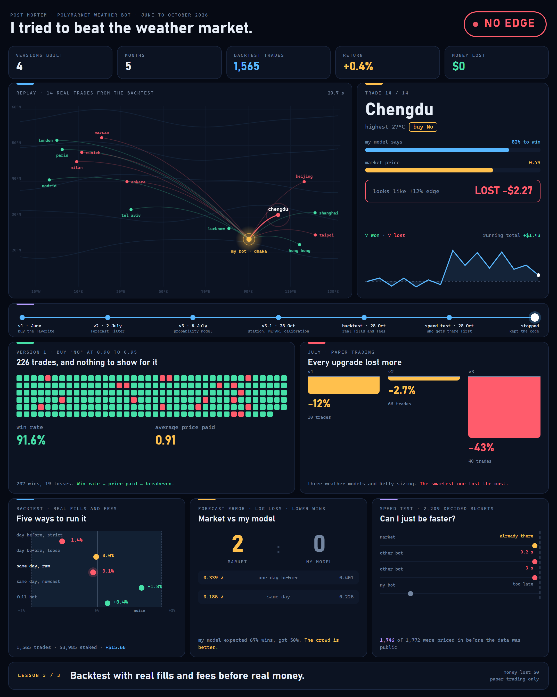

# Polymarket weather bot (it did not work)

I spent about five months trying to beat Polymarket's daily temperature markets with a bot. I built four versions, added three weather models, then backtested the last one properly. It has no edge. This repo is the code and the numbers, so you can check it yourself or skip the same mistakes.

[](media/weather_bot_board.mp4)

Everything here ran as paper trading (`DRY_RUN = True`). No money was lost.

## The short version

| Step | What I tried | What happened |
|---|---|---|
| v1 | Buy "No" on buckets the market already favours (around 0.90) and hold | 207 wins, 19 losses, 91.6% win rate, average price 0.91. That is breakeven. |
| v2 | Same, but only when the forecast is at least 2°C away from the bucket | July paper trading: -2.7% over 66 trades |
| v3 | GFS 31 member ensemble, ECMWF + ICON consensus, Kelly sizing, 8% minimum edge | July paper trading: -43% over 40 trades |
| v3.1 | Forecast at the exact settlement station, live METAR for same day markets, per station calibration, correct fees | Backtested instead of traded |
| Backtest | 1,788 events, real taker fills within 30 minutes, real fees, walk forward | 1,565 trades, $3,985 staked, +$15.66 (+0.4%). Noise. |
| Speed test | Buy when a new weather report has already decided a bucket | 1,746 of 1,772 were priced in before the report was public. Other bots took the rest in 0 to 5 seconds. |

The model expected to win 67% of its trades. It won 50%, the same as the average price it paid. Log loss (lower is better): market 0.339 vs model 0.401 a day before, market 0.185 vs model 0.225 on the day. The market price was the better forecast both times.

## Files that matter

| File | What it is |
|---|---|
| [`weather_bot_v3.py`](weather_bot_v3.py) | The last bot (v3.1). Probability model, station and METAR handling, EV and Kelly sizing, order path. Start here. |
| [`weather_backtest.py`](weather_backtest.py) | Replays the strategy against real fills and fees. This is what showed there is no edge. |
| [`weather_calibrate.py`](weather_calibrate.py) | Measures forecast bias and spread per station from settled markets and writes `weather_calibration.json`. |
| [`weather_speed_test.py`](weather_speed_test.py) | Checks how fast prices react when a weather report decides a bucket. |
| [`weather_bot_v1.py`](weather_bot_v1.py) | First bot: buy the favourite "No" and hold. |
| [`weather_bot_v2.py`](weather_bot_v2.py) | Second bot: v1 plus a forecast distance filter. |
| [`results/`](results) | Summaries of the backtest and the speed test, the source of every number above. |

### Where to look

| To change | Look at |
|---|---|
| How a bucket's probability is built | `get_forecast()` and `bucket_probability()` in `weather_bot_v3.py` |
| Same day markets (METAR nowcast) | `observed_extremes()` and `_nowcast()` |
| Minimum edge and stake size | `MIN_EDGE`, `KELLY_FRACTION`, `BANKROLL_USDC` near the top, and `kelly_stake()` |
| Which markets are scanned | `find_temperature_buckets()` (the 11:00 to 13:00 UTC end date bracket) |
| Fees and fills | `taker_fee_per_share()` and `book_fill()` |
| Backtest scenarios | the `scenarios` list in `main()` of `weather_backtest.py` |

## Run it

```bash
pip install -r requirements.txt
cp .env.example .env        # fill in only what you need
python weather_calibrate.py # writes weather_calibration.json (a recent copy is included)
python weather_bot_v3.py    # paper trades by default
python weather_backtest.py  # slow, downloads trade history, be kind to the API
```

`DRY_RUN = True` is the default in every bot. Leave it.

### Secrets

Every credential is read from the environment or a local `.env`, never from the code. `.env` is in `.gitignore`, keep it there.

| Variable | Used for |
|---|---|
| `POLY_PRIVATE_KEY`, `POLY_FUNDER` | Placing real orders (only when `DRY_RUN = False`) |
| `POLYMARKET_RELAYER_API_KEY` | Optional relayer key for the SDK |
| `TELEGRAM_BOT_TOKEN`, `TELEGRAM_CHAT_ID` | Trade notifications |
| `GMAIL_USER`, `GMAIL_APP_PASSWORD`, `GMAIL_TO` | Daily summary email |
| `TOMORROWIO_API_KEY` | Fallback forecast source in v1 and v2 |

Also ignored: the bot state files (`*_state.json`), the backtest cache and the full result files.

## What I learned

1. The market price is the probability. Free weather models do not beat it.
2. A high win rate means nothing without the price you paid.
3. Backtest with real fills and fees before you put money in.
4. Read the settlement rules first: which station, which rounding, which local date.

## Stack

Python, Open-Meteo (forecast, ensemble and previous runs APIs), aviationweather.gov METAR, Polymarket Gamma, CLOB and data APIs, Telegram Bot API.

## Notes

The backtest covers about half of the data I planned. I stopped downloading the rest so I would not hammer Polymarket's API. Prediction markets are risky and this is not financial advice.

MIT licensed.
